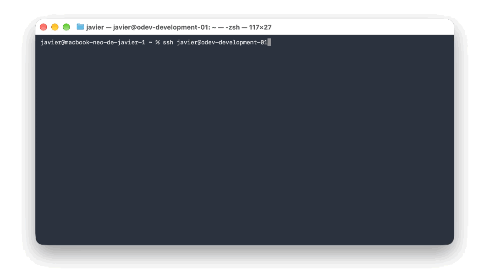

<p align="right">
<a href="https://oreol.ch">Oreol</a> <a href="https://oreolag.github.io/docs/cli/">Manual</a> <a href="https://github.com/oreolag/playbooks">Playbooks</a> <a href="https://github.com/oreolag/workflows">Workflows</a>
</p>

<p align="center" style="margin-bottom: 0px;">
  
</p>

<h1 align="center">
  Oreol CLI
  <p align="center">
    <a href="https://github.com/oreolag/cli/releases"></a>
    <a href="https://github.com/oreolag/cli/blob/main/LICENSE"></a>
    <a href="https://github.com/oreolag/cli/graphs/contributors"></a>
    <a href="https://github.com/oreolag/cli/stargazers"></a>
  </p>
</h1>

<!-- docs:cli_readme_intro:start -->
Oreol CLI, or ```odev```, is a command-line interface to your Oreol cluster for use in your terminal or scripts.

Building on the Heterogeneous Accelerated Compute Cluster CLI developed at ETH Zurich (see [hdev](https://github.com/fpgasystems/hdev) on GitHub), ```odev``` combines an integrated reservation system with automation through Ansible [playbooks](https://github.com/oreolag/workflows) to help you configure your infrastructure to meet your application requirements.

Community [workflows](https://github.com/oreolag/workflows) for popular HPC, ML, and AI environments bring together infrastructure configuration, device programming, and application execution across CPUs, GPUs, FPGAs, storage, and high-performance networking. By coordinating how applications use these resources, ```odev``` simplifies deployment and supports reproducible experimentation. Planned NUMA-aware execution will extend this approach by keeping workloads close to the devices and memory they use.
<!-- docs:cli_readme_intro:end -->

<!-- docs:cli_readme_installation:start -->
## Install with the Script
Run the following command on your Linux host (see [Supported Platforms](#supported-platforms)):

```bash
curl -H 'Cache-Control: no-cache' -fsSL https://oreol.ch/cli/install.sh | sudo bash
```

## Install with Oreol Management

Alternatively, use `omgmt` to install `odev` across your managed cluster. See the [Oreol MGMT installation guide.](https://oreolag.github.io/docs/mgmt/odev/installation/)
<!-- docs:cli_readme_installation:end -->

<!-- docs:cli_readme_supported_platforms:start -->
## Supported Platforms
`odev` currently supports Ubuntu-based Linux distributions. Validated environments include:

- Ubuntu
- NVIDIA DGX

Additional Linux distributions may work but are not officially validated yet.
<!-- docs:cli_readme_supported_platforms:end -->

<!-- docs:cli_readme_supported_how_it_works:start -->
## How It Works
`odev` treats NUMA-local heterogeneous resources as composable execution units. A workload can run inside a single NUMA unit for maximum locality, or across multiple NUMA units when larger models or distributed applications require more accelerators, memory, storage, or network bandwidth. Click [here](https://oreolag.github.io/docs/cli/how-it-works/) to learn more.

## Examples

### Booking a Server
`odev` includes a lightweight, configurable reservation system that can be hosted on any designated server in your cluster. Users can reserve resources for their work and use the integrated Ansible tooling to configure remote hosts and program supported devices.

```bash
odev reserve add --server odev-development-02 --start now
```

### Setting the MTU on Reserved Hosts
Use ```odev set mtu``` with ```--hosts all``` to target all hosts reserved by the current user.
<!-- docs:cli_readme_supported_how_it_works:end -->



## Citation

[](https://doi.org/10.5281/zenodo.20229347)
[](https://doi.org/10.1145/3805700)

<!-- docs:cli_readme_supported_citation:start -->
If you use `odev` in your research, development, or publications, please cite the following references:

```bibtex
@misc{moya2026odev,
  author       = {Javier Moya},
  title        = {oreolag/cli: odev},
  howpublished = {Zenodo},
  year         = {2026},
  note         = {\url{https://doi.org/10.5281/zenodo.20229347}},
  doi          = {10.5281/zenodo.20229347}
}
```

```bibtex
@article{moya2026hacc,
  author    = {Javier Moya and Matthias Gabathuler and Mario Ruiz and Gustavo Alonso},
  title     = {A Development Platform for Managed Heterogeneous Accelerated Compute Clusters: A Case Study on ETH Zurich’s AMD HACC},
  journal   = {ACM Transactions on Reconfigurable Technology and Systems},
  year      = {2026},
  doi       = {10.1145/3805700},
  url       = {https://doi.org/10.1145/3805700}
}
```
<!-- docs:cli_readme_supported_citation:end -->